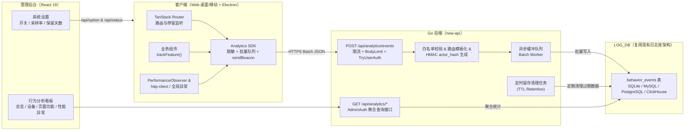

# 网站用户行为埋点与跨设备分析架构设计方案

## 1. 设计目标与隐私红线（零上下文原则）

本方案为 `new-api`（Web + Electron 客户端）设计一套**自建内置、隐私优先、零上下文采集、支持跨设备习惯分析**的行为埋点系统。

> **零上下文红线（强制执行，前后端双层拦截）**
> 1. **不采集任何用户输入与业务内容**：禁止采集对话/Prompt、搜索关键词、表单输入值、API Key、令牌内容、请求/响应体、模型输出、余额/充值具体金额等。
> 2. **不采集完整 URL Query / Hash**：路由路径强制模板化（如 `/channels/123` → `/channels/:id`），丢弃所有查询参数（避免泄漏 `token`、`code`、`promo`、`search` 等）。
> 3. **不存储明文用户身份与明文 IP**：日志表中不存 `user_id`、`username`、`email`、`ip` 明文；已登录用户仅存服务端不可逆匿名哈希 `actor_hash` 用于跨设备关联。
> 4. **严格白名单 Schema**：事件名与属性键均受服务端白名单约束，任何不在白名单内的属性字段或超长字符串在入库前直接丢弃。
> 5. **不影响主业务可用性**：前端批量异步发送 + 静默失败；后端独立限流 + 内存缓冲批量落库，队列满时丢弃事件而不阻塞业务。

---

## 2. 系统整体架构



---

## 3. 跨设备匿名化标识体系

为了在不记录任何明文用户信息和上下文的前提下，实现「同一用户在不同设备上的行为习惯分析」，采用**三层匿名标识**：

| 标识字段 | 生成方 | 生命周期与存储 | 作用 |
| :--- | :--- | :--- | :--- |
| `actor_hash` | **仅后端生成** | 登录态通过 `TryUserAuth()` 获取 `user_id`，计算 `HMAC-SHA256(analytics_salt, "u:" + user_id)` 截取 32 位 hex；未登录为空字符串 | 跨设备关联同一登录用户（PC Web、手机 Web、Electron 共享同一匿名哈希），无法从日志表反推原用户 |
| `device_id` | 前端生成 | `nanoid(21)` 持久化在 `localStorage`（不采集硬件/Canvas 指纹，清除缓存即重置） | 区分同一用户的不同设备，以及未登录访客的设备 UV |
| `session_id` | 前端生成 | `nanoid(21)` 存在 `sessionStorage`，单标签页有效，无操作超过 30 分钟自动轮换 | 串联单次访问链路、统计会话时长、页面跳转路径与跳出率 |

### 跨设备分析能力说明
- **多端用户识别**：按 `actor_hash != ''` 聚合 `COUNT(DISTINCT device_id)` 和 `COUNT(DISTINCT client_type)`，即可统计多设备用户占比（例如：同时使用 PC Web + 手机 Web，或 Web + Electron 的用户比例）。
- **分端习惯对比**：同一 `actor_hash` 在移动端是否偏向查看余额/日志/用量，在桌面端或 Electron 是否偏向 Playground/令牌/渠道配置。
- **匿名化盐管理**：`analytics_salt` 在首次开启埋点时由服务端随机生成 32 字节安全密钥并保存在系统配置中（不在 `/api/status` 暴露，不记入审计日志）。支持管理员在设置中主动轮换盐值以切断历史关联。

---

## 4. 存储模型与表结构设计

复用项目现有的 `LOG_DB`（参考 `model/audit_log.go` 与 `model/main.go`），同时完整兼容 **SQLite、MySQL >= 5.7.8、PostgreSQL >= 9.6、ClickHouse**。

### 4.1 `behavior_events` 表字段定义

| 字段名 | Go 类型 | SQL / ClickHouse 类型 | 索引 | 说明 |
| :--- | :--- | :--- | :--- | :--- |
| `id` | `int64` | PK 自增（ClickHouse 省略或用 `event_id` 排序） | PK | 主键 |
| `event_id` | `string` | `varchar(36)` | `uniqueIndex`（非 CH） | 客户端生成的幂等事件 ID，防止重试重复写入 |
| `created_at` | `int64` | `bigint`（Unix 秒级时间戳） | `index:idx_be_time_event` | 服务端接收/校准后的事件时间（防客户端时钟偏移） |
| `event_type` | `string` | `varchar(24)` | `index:idx_be_time_event` | 事件大类：`page_view` / `page_leave` / `feature_use` / `perf_vital` / `api_error` / `client_error` |
| `event_name` | `string` | `varchar(64)` | `index:idx_be_name_time` | 规范化事件名（白名单枚举），如 `playground.send`、`token.create` |
| `actor_hash` | `string` | `varchar(32)` | `index:idx_be_actor_time` | 登录用户不可逆 HMAC 哈希（匿名访问为 `""`） |
| `device_id` | `string` | `varchar(32)` | `index:idx_be_device_time` | 设备端匿名随机 ID |
| `session_id` | `string` | `varchar(32)` | `index` | 访问会话 ID |
| `route_path` | `string` | `varchar(128)` | `index` | 脱敏模板路由（如 `/channels/:id`，无 query/hash） |
| `from_route` | `string` | `varchar(128)` | - | 站内来源路由模板（外部来源则为空） |
| `referrer_host` | `string` | `varchar(128)` | - | 外部来源域名（仅 host，不含路径与参数） |
| `client_type` | `string` | `varchar(24)` | `index` | `web_desktop` / `web_mobile` / `web_tablet` / `electron_desktop` |
| `os_family` | `string` | `varchar(24)` | - | `windows` / `macos` / `ios` / `android` / `linux` / `other` |
| `browser_family` | `string` | `varchar(24)` | - | `chrome` / `safari` / `edge` / `firefox` / `electron` / `other` |
| `viewport_bucket` | `string` | `varchar(16)` | - | 屏幕视口分桶：`xs`(<640) / `sm`(640-767) / `md`(768-1023) / `lg`(1024-1279) / `xl`(1280-1535) / `2xl`(>=1536) |
| `lang` | `string` | `varchar(16)` | - | 界面语言代码（如 `zh`、`en`、`zh-TW`、`ja` 等） |
| `theme` | `string` | `varchar(16)` | - | 主题模式：`light` / `dark` / `system` |
| `tz_offset` | `int16` | `smallint` | - | 客户端时区偏移分钟数（如东八区 `-480`），用于还原用户本地活跃时段 |
| `duration_ms` | `int32` | `int` | - | 通用耗时/停留时长（毫秒）：`page_leave` 存停留时长、`perf_vital` 存指标耗时、`api_error` 存请求耗时 |
| `status_code` | `int16` | `smallint` | - | 仅 `api_error` 使用（HTTP 状态码，其余为 0） |
| `props` | `string` | `text` | - | 仅存经服务端白名单校验后的精简 JSON（上限 512 字节），**不使用数据库特有 JSON 类型**以保证四库兼容 |

### 4.2 四数据库兼容策略
- **SQLite / MySQL / PostgreSQL**：统一通过 `LOG_DB.AutoMigrate(&BehaviorEvent{})` 管理，所有聚合 SQL 使用标准 ANSI 语法与 GORM 构造，不依赖特定数据库的 JSON 提取函数（高频分析维度如 `client_type`、`os_family`、`route_path`、`event_name`、`duration_ms`、`status_code` 全部提升为独立标量列，查询快速且天然跨库）。
- **ClickHouse**：独立建表语句使用 `MergeTree() PARTITION BY toYYYYMM(toDateTime(created_at)) ORDER BY (event_type, created_at, device_id)`，并原生支持 `TTL toDateTime(created_at) + INTERVAL N DAY`。

---

## 5. 四大维度事件目录与属性白名单

所有事件均禁止携带任何用户输入的自由文本。下表定义允许上报的事件与属性白名单：

### 5.1 页面访问与停留
| `event_type` | `event_name` | 关键字段与 `props` 白名单 | 采集时机 |
| :--- | :--- | :--- | :--- |
| `page_view` | `route.enter` | `route_path`, `from_route`, `referrer_host`, `props`: `{ "is_auth": bool }` | 每次 TanStack Router 路径切换时触发 |
| `page_leave` | `route.leave` | `route_path`, `duration_ms`（总停留，上限 3600000ms）, `props`: `{ "active_ms": int, "reason": "navigate" \| "hide" \| "unload" }` | 路由切换、页面切后台 (`visibilitychange`) 或关闭 (`pagehide`) 时触发 |

### 5.2 核心功能使用习惯
通过统一的 `trackFeature(eventName, props)` 埋点函数在关键交互点触发（仅记录枚举/布尔/计数，绝不记录内容）：

| 模块 | `event_name` | `props` 白名单（示例） | 不记录的内容（明确排除） |
| :--- | :--- | :--- | :--- |
| Playground / Chat | `playground.request_submit` | `{ "stream": bool, "has_image": bool, "provider_family": enum }` | Prompt 文本、回答内容、具体模型自定义参数值 |
| 模型与定价 | `pricing.filter_change` / `models.view_detail` | `{ "tab": enum, "filter_type": enum }` | 用户输入的搜索词 |
| 令牌管理 (Keys) | `token.create` / `token.copy` / `token.toggle` | `{ "has_expiry": bool, "has_quota_limit": bool }` | Token 明文、Token 名称、具体额度数字 |
| 用量日志 | `usage_log.filter` / `usage_log.export` | `{ "range_bucket": "24h" \| "7d" \| "30d" \| "custom", "format": enum }` | 搜索词、筛选的用户名/Token 名 |
| 钱包与订阅 | `wallet.topup_open` / `wallet.redeem_submit` / `subscription.view` | `{ "pay_method": enum, "result": "ok" \| "fail" }` | 兑换码、充值金额、订单号 |
| 偏好设置 | `preference.theme_change` / `preference.lang_change` / `preference.sidebar_toggle` | `{ "value": enum }` | - |
| 认证习惯 | `auth.login_method_select` | `{ "method": "password" \| "passkey" \| "oauth" \| "wechat" }` | 账号名、密码、验证码、OAuth token |
| 新手引导 | `onboarding.step_complete` / `onboarding.skip` | `{ "step": int }` | 测试请求内容 |

### 5.3 设备与环境维度（随每批事件公共上下文自动附带）
- **端类型判定 `client_type`**：
  1. 若 `window.electron?.isElectron === true`（已在 `electron/preload.js` 暴露）→ `electron_desktop`
  2. 否则结合 UA 与触摸/视口特征归类为 `web_mobile` / `web_tablet` / `web_desktop`
- **环境字段**：`os_family`、`browser_family`、`viewport_bucket`、`lang`、`theme`、`tz_offset`（服务端对上报的 `os_family` / `browser_family` 做规范枚举校验，不存储原始冗长 `User-Agent` 字符串以防高熵指纹化）。

### 5.4 前端性能与异常
| `event_type` | `event_name` | 关键字段与 `props` 白名单 | 脱敏规则 |
| :--- | :--- | :--- | :--- |
| `perf_vital` | `vital.fcp` / `vital.lcp` / `vital.ttfb` / `vital.route_change` | `route_path`, `duration_ms`, `props`: `{ "nav_type": "navigate" \| "reload" \| "back_forward" }` | 仅采集数值型耗时，每次加载仅报一次 |
| `api_error` | `api.request_failed` | `route_path`, `duration_ms`, `status_code`, `props`: `{ "api_route": template_path, "method": "GET" \| "POST" \| ..., "kind": "http_4xx" \| "http_5xx" \| "network" \| "timeout" }` | **接口路径必须做 ID 归一化**（`/api/channel/12` → `/api/channel/:id`）；丢弃 query、请求体、响应体及错误详情文本；跳过 `/api/analytics/*` 自身防递归 |
| `client_error` | `runtime.error` / `runtime.unhandled_rejection` | `route_path`, `props`: `{ "error_name": enum_or_short_type, "source": "window" \| "promise" \| "react_boundary" }` | 仅记错误构造类型（如 `TypeError`、`ChunkLoadError`），**不记 `error.message` 原文与含路径/数据的堆栈** |

---

## 6. 前端埋点 SDK 设计

在 `web/src/lib/analytics/` 下实现零外部依赖的轻量模块：

```text
web/src/lib/analytics/
├── index.ts          # 对外导出 initAnalytics / trackPageView / trackFeature / trackApiError / trackClientError
├── context.ts        # device_id / session_id 管理、设备与环境探测（含 Electron 检测）
├── sanitize.ts       # 路由参数模板化（:id/:code 替换）、query/hash 剥离、props 白名单过滤
├── transport.ts      # 内存批量队列（上限 100 条）、定时 flush（5s 或满 20 条）、sendBeacon 离页补发
├── vitals.ts         # PerformanceObserver (FCP/LCP/TTFB) 与全局错误监听
└── analytics.test.ts # 单元测试（脱敏、批量发送、采样、DNT、防递归）
```

### 集成挂载点
1. **全局初始化与路由追踪**：在 `web/src/routes/__root.tsx` 中挂载 `useAnalyticsTracker()`：
   - 订阅 `/api/status` 返回的 `analytics_enabled` 与 `analytics_sample_rate`，基于 `device_id` 做确定性采样（保证同一设备会话内要么全采样要么不采样，避免链路断裂）。
   - 监听 `location.pathname` 变化自动触发上个页面的 `page_leave` 与新页面的 `page_view`。
   - 监听 `document.visibilitychange` 精确计算页面实际活跃可见时长 `active_ms`。
2. **接口异常钩子**：在 `web/src/lib/http-client.ts` 的 axios 拦截器中，对非 2xx / 网络错误调用 `trackApiError()`（排除 `401` 自动刷新重试成功的情况，且严格排除 `/api/analytics/` 路径）。
3. **关键功能埋点**：在 Playground、Chat、Keys、Wallet、Pricing、Usage Logs、Auth、Onboarding 等核心交互点按需调用 `trackFeature()`。

---

## 7. 后端接口、配置与并发安全设计

### 7.1 系统配置（`setting/operation_setting/analytics_setting.go`）
沿用 `setting/operation_setting/log_setting.go` 模式注册到 `config.GlobalConfig`：
- `analytics_setting.enabled`（`bool`，默认 `false`，由管理员显式开启以尊重合规与隐私选择）
- `analytics_setting.sample_rate`（`int`，`1-100`，默认 `100`）
- `analytics_setting.retention_days`（`int`，`7-365`，默认 `90`）
- `analytics_setting.respect_dnt`（`bool`，默认 `true`，遵循浏览器 `Do Not Track`）
- `analytics_setting.hash_salt`（`string`，服务端自动生成的随机秘钥，**仅后端可读，不暴露给公开 `/api/status`**）

在 `controller/misc.go` 的 `GetStatus` 中仅暴露：
```json
"analytics_enabled": true,
"analytics_sample_rate": 100,
"analytics_respect_dnt": true
```

### 7.2 路由与权限设计（`router/api-router.go`）
- **事件上报接口**（允许匿名与登录态调用）：
  - `POST /api/analytics/events`
  - 中间件：`AnalyticsRateLimit()`（每 IP 每分钟限流防刷）+ `AnonymousRequestBodyLimit()`（单次请求体最大 32KB、事件数组最多 50 条）+ `middleware.TryUserAuth()`（若有登录会话则提取 `user_id` 计算 `actor_hash`，无会话则匿名处理）。
  - 返回：`202 Accepted`（配置关闭或静默忽略时同样返回 `202`）。
- **管理后台分析查询接口**（仅管理员）：
  - 路由组 `/api/analytics/*`，使用 `middleware.DisableCache()` + `middleware.AdminAuth()`（如适用可接入 Casbin 权限点）。
  - `GET /api/analytics/overview?start_ts=&end_ts=&client_type=` — 总览 KPI（PV、设备 UV、跨设备登录活跃数、多端用户占比、平均活跃停留时长、接口错误率）
  - `GET /api/analytics/trends?start_ts=&end_ts=&granularity=hour|day` — 访问趋势 + 24小时活跃时段分布（支持按 `tz_offset` 还原用户本地小时）
  - `GET /api/analytics/devices?start_ts=&end_ts=` — 设备端型、OS、浏览器、视口分桶、语言、主题、多设备组合分布
  - `GET /api/analytics/pages?start_ts=&end_ts=&client_type=` — 热门页面排行（PV、UV、平均停留时长、活跃停留时长）
  - `GET /api/analytics/features?start_ts=&end_ts=&client_type=` — 热门功能使用频次、模块分布、桌面端 vs 移动端 vs Electron 使用差异
  - `GET /api/analytics/health?start_ts=&end_ts=` — FCP/LCP/TTFB/路由切换 P50 & P95、API 错误码与路由分布、前端异常类型排行
  - `POST /api/analytics/salt/rotate` — 管理员主动轮换匿名哈希盐（Root 权限）
  - `DELETE /api/analytics/expired` — 手动触发清理过期埋点日志（Root 权限）

### 7.3 异步批量落库与背压保护（`service/analytics_writer.go`）
- 内存有界通道（如容量 `4096` 条事件）+ 后台 worker：每累计 `100` 条或每 `2 秒` 执行一次 `LOG_DB.CreateInBatches(batch, 100)`。
- 优雅退出时在进程关闭钩子中 flush 剩余缓冲数据。
- 若缓冲队列已满（突发流量或数据库抖动），直接丢弃新事件并记录限频告警日志，绝不阻塞 HTTP Goroutine。

---

## 8. 管理后台可视化看板与设置 UI

遵循 `web/AGENTS.md`（优先复用现有共享组件、图表库 `recharts` / `@visactor/react-vchart`、`@/lib/format`、`toIntlLocale`，以及全 7 语言 `i18n` 翻译）。

### 8.1 新增「行为分析」管理页面
路径：`/analytics`（对应 `web/src/routes/_authenticated/analytics/` 与 `web/src/features/analytics/`），支持全局时间范围筛选（今日 / 近 7 天 / 近 30 天 / 自定义）与端类型筛选（全部 / Web 桌面 / Web 移动 / Web 平板 / Electron）：

1. **总览与活跃习惯（Overview）**
   - 顶部 KPI 卡片：总 PV、独立设备数（Device UV）、匿名登录活跃人数（Actor UV）、多设备用户占比、平均页面活跃停留、接口错误率
   - PV / UV 折线趋势图
   - 活跃时段分布柱状图 / 热力图（按用户本地时间还原，直观看出用户作息高峰）
2. **设备与跨端分析（Devices）**
   - 客户端类型饼图/环形图（Web 桌面 vs Web 移动 vs 平板 vs Electron）
   - OS、浏览器、屏幕视口分桶、界面语言、深浅色主题分布横向柱状图
   - 跨设备组合洞察（仅单端 vs PC+移动 vs Web+Electron 等用户占比）
3. **页面与功能习惯（Behavior）**
   - 热门页面排行表（路由模板、PV、UV、平均停留、活跃停留）
   - 核心功能使用频次排行 + 按客户端类型分组对比（例如对比移动端和桌面端最常用功能的差异）
4. **性能与异常（Health）**
   - 首屏 FCP / LCP / TTFB / 路由切换 P50 & P95 指标卡与趋势
   - 接口失败 Top 路由表（接口模板、状态码、失败次数、平均耗时）
   - 前端运行时异常类型分布

### 8.2 系统设置新增「行为埋点」配置
在系统设置的日志/运营配置区域增加配置卡片：
- 启用行为埋点日志开关（明确提示：不采集对话内容、请求体及用户明文身份）
- 采样率滑块 / 输入（1% ~ 100%）
- 数据保留天数（7 ~ 365 天）
- 遵循浏览器 DNT 开关
- 「轮换匿名哈希盐」按钮（带 `ConfirmDialog` 二次确认，说明轮换后将重新开始跨设备关联）

---

## 9. 分阶段实施计划与验证矩阵

| 阶段 | 交付内容 | 验证方式 |
| :--- | :--- | :--- |
| **Phase 1: 后端基础设施** | `model/behavior_event.go`、`setting/operation_setting/analytics_setting.go`、`service/analytics_*.go`、`controller/analytics.go`、路由与限流、保留清理定时任务 | 1. Go 单元测试（白名单脱敏、HMAC 跨设备一致性与不可逆性、队列背压丢弃、参数校验）<br>2. **四数据库实测**：在真实 SQLite、MySQL、PostgreSQL（及 ClickHouse 如环境可用）执行冷启动迁移、重复重启幂等性、批量写入与聚合查询验证 |
| **Phase 2: 前端埋点 SDK** | `web/src/lib/analytics/*`、挂钩 `__root.tsx` 与 `http-client.ts`、核心业务模块 `trackFeature()` 接入 | 1. Vitest 单元测试（路由脱敏、query 剥离、Electron 识别、批量队列 & sendBeacon、采样率、DNT）<br>2. 本地联调确认零敏感字段上报 |
| **Phase 3: 后端聚合 & 管理看板** | `/api/analytics/*` 聚合统计接口、管理后台「行为分析」4-Tab 看板、系统设置配置、7 国语言 i18n 补全 | 1. 后端聚合接口回归测试（权限拦截、跨设备统计正确性、时间窗口边界）<br>2. 前端 `bun run typecheck && bun run lint && bun run test && bun run build` |

---

## 10. 待确认决策

1. **默认开关状态**：新建站或升级后默认关闭埋点（`enabled: false`），由管理员在系统设置中手动开启，还是默认直接开启？
2. **存储与留存策略**：复用现有 `LOG_DB`（支持独立日志库/ClickHouse），默认保留 **90 天**并自动定期清理。
3. **权限范围**：分析看板仅 **Admin / Root** 可见；轮换匿名哈希盐和手动清理过期日志仅 **Root** 可操作。
