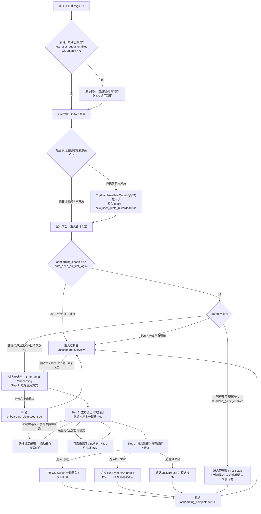

# 用户引导（First Setup）与注册赠送配置优化实施计划

> 状态：待评审 / 待开发  
> 创建日期：2026-11-26  
> 关联模块：`web/src/features/setup/`、`web/src/features/dashboard/components/overview/`、`web/src/features/system-settings/`、`setting/operation_setting/`、`model/user.go`、`controller/misc.go`

---

## 1. 背景与目标

当前用户注册并登录 New API 控制台后，默认落点为 `/dashboard/overview`。尽管总览页顶部已存在 `Setup guide` 卡片，但新用户依然普遍出现“登录后不知道该干嘛”的困惑，核心原因包括：

1. **首屏信息过载**：未完成初始化的新手同时面对 3 步静态清单、被截断的 `curl` 预览、右侧重复的 `Recommended actions`、4 张全为 `0` 的统计卡（余额为 0 时甚至直接亮红点提示 `Balance depleted`）以及公告/FAQ/监控面板，缺乏唯一明确的主行动（Primary CTA）。
2. **跳转打断心流**：现有清单项全部是跳转链接（跳去 `/keys` 填完整抽屉、跳去 `/wallet`、跳去 `/playground`），完成一步后需用户自行找回引导页，没有形成“拿 Key → 接入 → 跑通第一次请求”的闭环。
3. **高价值接入能力藏得太深**：仓库已内置的 `CCSwitchDialog`（`ccswitch://v1/import` 一键导入 Claude / Codex / Gemini）隐藏在 `/keys` 行内下拉菜单中，首页 `RequestPreview` 仅展示一条截断的 `curl`。
4. **未区分角色与运行模式**：管理员刚完成 `/setup` 初始化后首次登录最需要的是“配置首个上游渠道”，而非“充值”；自用模式（`SelfUseModeEnabled`）下仍提示“添加额度”。
5. **注册赠送与新手引导缺少清晰的后台开关体系**：
   - 后端虽已有 `QuotaForNewUser` 与防重复发放逻辑 `model.TryGrantNewUserQuota`，但没有独立的**启用/停用开关**（停用只能把金额改回 `0`，丢失原配置），且硬编码了邮箱验证前提、未在 `/api/status` 中对前端暴露，导致注册页和新手引导无法告知用户“注册/验证邮箱即赠额度”。
   - 新手引导本身缺少后台功能开关，运营方无法按站点需要开启/关闭自动弹出或子功能（如内联测试请求、CC Switch 推荐）。

### 目标

- 复用现有系统初始化向导 `/setup`（`SetupWizard`）的分步向导交互范式，构建**面向用户的 First Setup 首次引导向导**，与 Overview 现有 `Setup guide` 形成“聚焦引导 + 总览兜底”双层协同。
- 在后台系统设置中提供**注册赠送独立开关 + 赠送金额 + 发放前置条件**，以及**新手引导功能开关组**，做到可灰度、可停用、可按站点模式自适应。
- 同步优化 Overview 总览页的空状态、代码预览和状态存储，修复多账号 `localStorage` 串状态等细节问题。

---

## 2. 现有能力盘点与差距分析

| 维度 | 现有实现位置 | 当前能力 | 待优化/补齐点 |
|---|---|---|---|
| 系统首启向导 | `web/src/features/setup/setup-wizard.tsx` | 4 步卡片进度条 + 单步聚焦 + `StepNavigation` | 仅限部署初始化 `/setup`，未抽离为可复用向导壳；初始化完成后跳 `/` 而非 `/sign-in` |
| 总览设置引导 | `web/src/features/dashboard/components/overview/overview-dashboard.tsx` | 3 步完成态检测（Key / Quota / Request）+ 折叠切换 | 仅支持跳页；右侧 `Recommended actions` 冗余；未区分管理员与自用模式；`localStorage` key 未按 `user.id` 隔离 |
| 首个请求预览 | `web/src/features/dashboard/components/overview/request-preview.tsx` | 单条 `curl` 预览 + 一键复制真实 Key | 代码行使用 `truncate` 被截断；无客户端/语言 Tab；未联动 `CCSwitchDialog` |
| 客户端一键导入 | `web/src/features/keys/components/dialogs/cc-switch-dialog.tsx` | 支持 Claude / Codex / Gemini 一键 `ccswitch://` 导入 | 仅藏在 `/keys` 行操作菜单中，新手难以发现 |
| 余额统计卡 | `web/src/features/dashboard/components/overview/summary-cards.tsx` | 余额、24h 用量、Runway 健康状态 | 刚注册 0 余额新用户直接显示红色 `Balance depleted` |
| 注册赠送后端 | `common/constants.go`、`model/option.go`、`model/user.go:TryGrantNewUserQuota` | `QuotaForNewUser` + 行锁防重 `NewUserQuotaRewarded` + 缓存同步 | 缺少独立开关 `enabled`；未开放非邮箱验证场景可选项；未在 `/api/status` 暴露状态 |
| 注册赠送后台 UI | `web/src/features/system-settings/general/quota-settings-section.tsx` | `QuotaForNewUser` 金额输入（自动按当前货币换算） | 缺少总开关与生效规则说明 |
| 用户偏好存储 | `relaykit/dto/user_settings.go` | `UserSetting` JSON 结构（已存边栏、语言、计费偏好等） | 尚未存储用户引导完成/跳过状态（前端仅用全局 `localStorage`） |

---

## 3. 总体设计方案

### 3.1 后台配置与功能开关设计

沿用项目现有的 `setting/config.GlobalConfig.Register` 模式（参照 `setting/operation_setting/checkin_setting.go`、`quota_setting.go` 与 `setting/console_setting/config.go`），拆分两组配置：

#### A. 注册赠送配置（扩展 `quota_setting` + 复用 `QuotaForNewUser`）

存放位置：
- 后端配置：`setting/operation_setting/quota_setting.go`（与既有 `QuotaForNewUser` 协同）
- 后台设置页面：`/system-settings/billing/quota`（`web/src/features/system-settings/general/quota-settings-section.tsx`）

| Option Key | 类型 | 默认值 | 说明 |
|---|---|---|---|
| `quota_setting.new_user_quota_enabled` | `bool` | `false`（升级兼容见下方） | **注册赠送总开关**。关闭时不发放新用户额度，但保留已填写的 `QuotaForNewUser` 金额便于再次开启 |
| `QuotaForNewUser` | `int`（原始 quota 单位，500000 = $1） | `0`（沿用现有） | **注册赠送金额**。前端继续以当前货币面额编辑（`quotaUnitsToDollars` / `parseQuotaFromDollars`）；总开关关闭时输入框置灰但保留原值 |
| `quota_setting.new_user_quota_require_email` | `bool` | `true` | **防薅开关：仅在验证/绑定邮箱后发放**。默认 `true` 与现网行为 100% 一致；关闭后支持未开启邮箱验证的站点在注册完成时直接发放（依然受 `User.NewUserQuotaRewarded` 行锁幂等保护） |

> **向后兼容策略**：若历史站点数据库中已有 `QuotaForNewUser > 0` 但不存在 `quota_setting.new_user_quota_enabled` 键，后端启动加载配置时自动将其初始化为 `true`，确保升级后老站点的注册赠送行为不意外中断。

发放逻辑调整（`model/user.go:TryGrantNewUserQuota` & `controller/user.go`）：
1. 入口判定改为：`!operation_setting.IsNewUserQuotaEnabled() || common.QuotaForNewUser <= 0` 直接返回。
2. 当 `new_user_quota_require_email == true` 时：保持现有逻辑，仅在 `strings.TrimSpace(user.Email) != ""` 时发放（触发点：邮箱验证注册、OAuth 补绑邮箱、后续用户中心绑定邮箱）。
3. 当 `new_user_quota_require_email == false` 时：注册完成后（`controller/user.go` `Register` 及 OAuth 新建用户路径）直接调用 `TryGrantNewUserQuota`，不再要求 `Email != ""`，但仍通过 `LockForUpdate` + `NewUserQuotaRewarded` 严格保证每人终身最多发放一次。
4. 金额边界校验：在 `controller/option.go` 保存 `QuotaForNewUser` 时校验 `>= 0` 且不超过 `common.MaxWalletQuota` 合理上限。

#### B. 用户引导（First Setup）功能开关（新增 `onboarding_setting`）

存放位置：
- 后端配置：新增 `setting/operation_setting/onboarding_setting.go`（注册命名空间 `onboarding_setting`）
- 后台设置页面：`/system-settings/operations/onboarding`（或并入 `/system-settings/operations/behavior` 下的独立设置卡片 `OnboardingSettingsSection`，推荐独立 Section 方便后续扩展）

| Option Key | 类型 | 默认值 | 说明 |
|---|---|---|---|
| `onboarding_setting.enabled` | `bool` | `true` | **用户引导总开关**。关闭后隐藏 First Setup 向导及入口，用户登录后直接进入 `/dashboard/overview` |
| `onboarding_setting.auto_open_on_first_login` | `bool` | `true` | **首次登录自动进入向导**。开启时满足条件的新用户登录后自动进入 First Setup；关闭时仅在侧边栏/Overview 保留“快速开始”手动入口 |
| `onboarding_setting.allow_inline_test_request` | `bool` | `true` | **向导内一键测试请求**。控制 Step 3 是否展示“发送测试请求”按钮（防止部分站点不希望在引导页产生测试调用） |
| `onboarding_setting.show_cc_switch` | `bool` | `true` | **展示 CC Switch 一键导入**。控制向导与 Overview 代码预览中是否优先露出 CC Switch 接入标签 |
| `onboarding_setting.admin_guide_enabled` | `bool` | `true` | **管理员首启引导开关**。开启时，管理员登录且上游渠道数为 `0` 时进入管理员渠道配置向导 |

#### C. `/api/status` 公开状态字段扩展（`controller/misc.go`）

向 `GET /api/status` 返回的 `data` 中新增以下只读字段（不泄露敏感配置）：

```json
{
  "onboarding_enabled": true,
  "onboarding_auto_open": true,
  "onboarding_inline_test_enabled": true,
  "onboarding_cc_switch_enabled": true,
  "onboarding_admin_guide_enabled": true,
  "new_user_quota_enabled": true,
  "new_user_quota_amount": 500000,
  "new_user_quota_require_email": true
}
```

> 说明：仅当 `new_user_quota_enabled == true && common.QuotaForNewUser > 0` 时返回正数 `new_user_quota_amount`，否则返回 `0`。前端注册页与 First Setup 向导据此展示“注册即赠 / 绑定邮箱即赠”提示。

---

### 3.2 复用已有 `SetupWizard`，构建「User First Setup」引导向导

#### 1. 抽离公共向导骨架 `<WizardShell>`

从 `web/src/features/setup/setup-wizard.tsx` 中抽离出与业务逻辑解耦的展示组件：
- `web/src/components/wizard/wizard-shell.tsx`（含品牌头、顶部步骤条 `ol.grid`、内容卡片容器、底部 `StepNavigation` + 可选顶部“跳过”按钮）
- 原 `/setup` 系统初始化向导改用 `<WizardShell>`，保持 100% 原有行为与测试通过。
- 新增 `web/src/features/onboarding/` 目录，承载用户版与管理员版 First Setup，视觉和 KuCode 主题保持完全一致。

#### 2. 路由与触发流程

- **新增受保护路由**：`/_authenticated/onboarding`（`web/src/routes/_authenticated/onboarding/index.tsx`）。
- **自动触发条件**（在登录重定向或 `OverviewDashboard` 首屏判定，仅在 `status.onboarding_enabled && status.onboarding_auto_open` 时生效）：
  - **普通用户**：`user.role < ROLE.ADMIN` 且尚未跳过/完成引导 且（无 API Key **且** `user.request_count === 0`）。
  - **管理员**：`status.onboarding_admin_guide_enabled` 为真 且 `user.role >= ROLE.ADMIN` 且尚未跳过/完成引导 且系统渠道总数为 `0`。
- **低打扰与可重入**：
  - 向导右上角始终提供 **“跳过，直接进入控制台”** 按钮，点击后标记 `dismissed` 并跳转 `/dashboard/overview`。
  - 侧边栏底部或 Overview 顶栏保留 **“快速开始 / Setup guide”** 入口，用户任何时候都可手动打开 `/onboarding` 重新配置或一键导入新客户端。
- **与现有 `/setup` 衔接**：
  - `web/src/features/setup/setup-wizard.tsx` 初始化提交成功后，将跳转目标从 `/` 改为 `/sign-in?from=setup`，管理员登录后直接衔接管理员 First Setup。

#### 3. 普通用户 First Setup（3 步就地闭环）

| 步骤 | 标题 | 核心交互与复用能力 |
|---|---|---|
| **Step 1** | **选择使用方式** | 复用 `UsageModeStep` 的 3 张大卡片单选，按用户意图定制第 3 步内容：<br>1. **AI 编程 / 客户端**（Claude Code / CC Switch / Codex / Gemini）<br>2. **代码 / API 集成**（OpenAI / Anthropic SDK、curl）<br>3. **先在线体验**（Playground 对话测试）<br>*若后台关闭了 `show_cc_switch`，卡片 1 调整为通用客户端接入描述。* |
| **Step 2** | **准备额度与 API Key** | **区块 A — 额度就绪态（联动注册赠送配置）**：<br>- `SelfUseModeEnabled` 开启时自动隐藏额度区块；<br>- 若 `user.quota > 0`：展示绿标“当前可用余额 $X”（若 `user.new_user_quota_rewarded` 为真，附带“含注册赠送额度”徽章）；<br>- 若 `user.quota === 0` 且开启了注册赠送 & 需绑邮箱 & 用户未绑邮箱：高亮展示“绑定邮箱立领 $X 免费额度”快捷引导（跳转或内联触发绑定邮箱流程）；<br>- 否则提示“当前余额为 0”，提供去充值 `/wallet` / 兑换码入口，同时明确允许“先创建 Key，稍后再充值”。<br><br>**区块 B — 极简一键创建 API Key（不跳页）**：<br>- 若已有可用 Key（`preferredKey`）：默认选中并展示“已检测到可用密钥”，支持一键复制真实 Key（调 `fetchTokenKey`）或另建新 Key；<br>- 若无 Key：仅提供一个名称输入框（默认预填如 `Claude Code` 或 `Default Key`），点击即调用 `createApiKey`（默认无限额、不过期、默认分组），创建后立即回显完整 `sk-...` 并支持一键复制。 |
| **Step 3** | **接入并验证首次调用** | 按 Step 1 选择渲染对应接入卡片：<br>- **AI 编程工具**：内嵌复用 `CCSwitchDialog` 核心配置区（选择 Claude / Codex / Gemini + 模型 → 一键唤起 `ccswitch://v1/import`），下方折叠展示手动 JSON 配置（复用 `createCcSwitchGuide`）与 `/docs` 文档链接；<br>- **代码 / API 集成**：提供 `curl` / `Python (OpenAI)` / `Anthropic SDK` / `Node.js` 多 Tab 代码块，自动注入真实网关地址、刚创建的 Key 与可用模型，支持一键复制；若 `onboarding_inline_test_enabled == true`，提供**“发送测试请求”**按钮，直接发起一条最小对话请求并展示回复与耗时，实时点亮完成态；<br>- **在线体验**：展示推荐模型与已选 Key，主按钮一键跳往 `/playground` 并附带默认模型参数。 |

#### 4. 管理员 First Setup（无渠道首启闭环）

当管理员首次登录且渠道数为 `0` 时展示：
1. **Step 1：添加首个上游渠道** — 给出常见厂商（OpenAI / Anthropic / Gemini / OpenRouter / 自定义兼容）快捷引导，跳往 `/channels` 并支持返回继续，或内嵌简化添加表单。
2. **Step 2：检查可用模型与连通性** — 拉取渠道列表与 `/api/user/models` 验证模型已就绪。
3. **Step 3：创建首个 Key 并测试转发** — 复用普通用户 Step 2/3 的建 Key 与一键测试请求能力，确认整条转发链路跑通。

---

### 3.3 同步优化现有 `OverviewDashboard`（跳过后的兜底体验）

针对跳过向导或日常回到 `/dashboard/overview` 的用户，做以下精准改造：

1. **视觉降噪与焦点聚焦**（`overview-dashboard.tsx`、`setup-guide-parts.tsx`）：
   - 当新手引导未完成时，隐藏右侧与左侧重复的 `Recommended actions` 卡片，让主引导卡获得更充裕空间。
   - 识别第一个 `completed === false` 的步骤为 `activeStep`，给予高亮边框与主按钮 CTA；点“创建 API Key”支持就地打开极简创建弹窗，成功后原地刷新 `apiKeysQuery`。
   - 当 `SelfUseModeEnabled` 为真时，从 `startSteps` 中自动移除 `Add credits` 步骤（进度变为 `2` 步）。
   - 若后台关闭了 `onboarding_setting.enabled`，顶部“打开 First Setup 向导”入口隐藏，仅按配置展示 Overview 基础内容。
2. **升级 `RequestPreview`**（`request-preview.tsx`）：
   - 去掉代码行的 `truncate`，改为 `overflow-x-auto` 横向滚动，完整可读。
   - 新增客户端/代码 Tab（`CC Switch` / `curl` / `Python`），当 `show_cc_switch` 开启时允许直接从首页触发 `CCSwitchDialog`。
   - 增加 `/docs` 文档入口与“在 Playground 中测试”快捷按钮。
3. **柔化新用户空状态文案**（`summary-cards.tsx`）：
   - `getHealthLevel` 区分“老用户余额用尽”与“新用户尚未充值”：当 `remainQuota <= 0 && usedQuota === 0 && requestCount === 0` 时，展示中性态 `Not topped up yet`（尚未充值）而非红色告警 `Balance depleted`（余额耗尽）；若开启了注册赠送且待绑定邮箱领取，可附带简短提示。
4. **修复多账号状态隔离与实时刷新**（`setup-guide.ts`、`overview-dashboard.tsx`）：
   - `SETUP_GUIDE_VISIBILITY_STORAGE_KEY` 与引导跳过状态在前端缓存层按 `user.id` 拼装（如 `dashboard_overview_setup_guide_expanded:u_${userId}`），避免同浏览器切换账号串状态。
   - 并在 Overview 挂载时确保用户最新 `quota` / `request_count` / `new_user_quota_rewarded` 同步，完成测试调用后进度条实时推进。

---

### 3.4 用户引导状态持久化（跨设备）

在 `relaykit/dto/user_settings.go` 的 `UserSetting` 中新增轻量可选字段（全部 `omitempty`，无数据库表结构迁移成本，直接复用 `users.setting` JSON 列）：

```go
OnboardingCompleted bool   `json:"onboarding_completed,omitempty"` // 是否已完成首次引导
OnboardingDismissed bool   `json:"onboarding_dismissed,omitempty"` // 是否主动跳过首次引导
OnboardingUseCase   string `json:"onboarding_use_case,omitempty"`  // 用户选择的接入场景 (coding / api / playground)
```

- 复用现有用户更新自身设置接口（或在 `controller/user.go` 提供最小 `PUT /api/user/onboarding` / 复用 `UpdateSelfSetting`），只允许更新上述白名单字段。
- 前端同时写入按 `user.id` 隔离的 `localStorage` 作为乐观缓存，避免页面闪烁。

---

### 3.5 新用户操作流程与界面示意图

#### 1. 端到端用户操作流程图



#### 2. 普通用户 First Setup 三步界面示意图（复用 `/setup` 向导壳）

##### Step 1：选择使用方式（消除茫然，按意图分流）

```text
+---------------------------------------------------------------------------------+
|  [Logo] 欢迎使用 New API                                   [语言]  [跳过，进控制台 >] |
|  按 3 个简单步骤完成首次配置，1 分钟内发起你的第一次 AI 请求                           |
+---------------------------------------------------------------------------------+
|  +-----------------------+  +-----------------------+  +-----------------------+ |
|  | [1] 选择使用方式   ●  |  | [2] 额度与 API Key    |  | [3] 接入并测试        | |
|  |     告诉我们你的场景   |  |     拿到可用密钥       |  |     跑通首次调用       | |
|  +-----------------------+  +-----------------------+  +-----------------------+ |
|                                                                                 |
|  你打算如何使用本平台？                                                            |
|                                                                                 |
|  +---------------------+   +---------------------+   +---------------------+   |
|  | (●) AI 编程 / 客户端 |   | ( ) 代码 / API 集成 |   | ( ) 先在线体验      |   |
|  |                     |   |                     |   |                     |   |
|  | Claude Code、Codex、|   | 在自己的应用中使用   |   | 无需配置本地工具，   |   |
|  | Gemini、CC Switch   |   | OpenAI / Anthropic  |   | 直接在 Playground   |   |
|  | 一键导入配置         |   | SDK 或 curl 调用    |   | 网页端对话试用       |   |
|  +---------------------+   +---------------------+   +---------------------+   |
|                                                                                 |
|---------------------------------------------------------------------------------|
|                                                                   [ 下一步 -> ] |
+---------------------------------------------------------------------------------+
```

##### Step 2：确认额度（联动注册赠送）+ 原地一键创建 API Key

```text
+---------------------------------------------------------------------------------+
|  [✓ 1. 选择使用方式]        [● 2. 额度与 API Key]        [3. 接入并测试]           |
+---------------------------------------------------------------------------------+
|                                                                                 |
|  ① 账户额度状态（自用模式下自动隐藏本区块）                                          |
|  +---------------------------------------------------------------------------+ |
|  | 状态 A（已获赠）: [✓] 当前可用额度 $1.00  [已含注册赠送]   [去充值]          | |
|  | 状态 B（待领赠）: [!] 绑定邮箱即可立即领取 $1.00 试用额度  [立即绑定邮箱]     | |
|  | 状态 C（0 余额）: [i] 当前余额 $0.00，可先建 Key 稍后充值  [去充值] [兑换码]  | |
|  +---------------------------------------------------------------------------+ |
|                                                                                 |
|  ② 创建你的第一个 API Key（无需跳页）                                             |
|  +---------------------------------------------------------------------------+ |
|  |  密钥名称: [ Claude Code                         ]   [ + 一键生成密钥 ]     | |
|  |                                                                           | |
|  |  -- 生成成功后原地回显（已有 Key 时默认选中并展示） --                       | |
|  |  [✓] 已就绪: Claude Code    sk-abc123...xyz9     [ 复制完整 Key ] [ 切换 ] | |
|  +---------------------------------------------------------------------------+ |
|                                                                                 |
|---------------------------------------------------------------------------------|
|  [ <- 上一步 ]                                                    [ 下一步 -> ] |
+---------------------------------------------------------------------------------+
```

##### Step 3：按所选场景接入并完成首次调用

```text
-- 分支 A：Step 1 选择了「AI 编程 / 客户端」 --
+---------------------------------------------------------------------------------+
|  [✓ 1. 选择使用方式]        [✓ 2. 额度与 API Key]        [● 3. 接入并测试]         |
+---------------------------------------------------------------------------------+
|  一键导入到 CC Switch（已自动带入网关地址与刚创建的 Key）                           |
|  +---------------------------------------------------------------------------+ |
|  | 应用类型:  (●) Claude    ( ) Codex    ( ) Gemini                           | |
|  | 推荐模型:  [ claude-opus-5-5 v ]          配置名: [ new-api            ]   | |
|  |                                                                           | |
|  | [ 一键打开 CC Switch 导入 ]    [ 查看完整接入文档 /docs ]                   | |
|  +---------------------------------------------------------------------------+ |
|  ▸ 展开手动配置 JSON（复制粘贴到 ~/.claude/settings.json）                         |
|---------------------------------------------------------------------------------|
|  [ <- 上一步 ]                                                [ 完成，进入控制台 ] |
+---------------------------------------------------------------------------------+

-- 分支 B：Step 1 选择了「代码 / API 集成」 --
+---------------------------------------------------------------------------------+
|  [✓ 1. 选择使用方式]        [✓ 2. 额度与 API Key]        [● 3. 接入并测试]         |
+---------------------------------------------------------------------------------+
|  快速调用示例（自动填充真实 Endpoint / Key / 推荐模型，横向可滚不截断）              |
|  [ curl ]  [ Python (OpenAI) ]  [ Anthropic SDK ]  [ Node.js ]      [ 复制代码 ] |
|  +---------------------------------------------------------------------------+ |
|  | curl https://api.example.com/v1/chat/completions \                        | |
|  |   -H "Authorization: Bearer sk-abc123...xyz9" \                           | |
|  |   -d '{"model":"gpt-4o-mini","messages":[{"role":"user","content":"Hi"}]}'| |
|  +---------------------------------------------------------------------------+ |
|                                                                                 |
|  （当后台开启 allow_inline_test_request 时显示）                                  |
|  [ ▶ 一键发送测试请求 ]   ->  [✓] 连接成功 · 耗时 640ms · 回复: "Hello! Ready."  |
|---------------------------------------------------------------------------------|
|  [ <- 上一步 ]                                                [ 完成，进入控制台 ] |
+---------------------------------------------------------------------------------+
```

#### 3. 跳过向导后的控制台总览（Overview 兜底态示意图）

```text
+---------------------------------------------------------------------------------+
|  Overview                                            [ 快速开始向导 ] [ 收起引导 ] |
+---------------------------------------------------------------------------------+
|  +---------------------------------------------------------------------------+ |
|  |  快速开始 (进度 1/3)                     |  [ CC Switch ] [ curl ] [ Python ]| |
|  |                                         |  +-----------------------------+ | |
|  |  [✓] 1. 创建 API Key                    |  | curl https://.../v1/chat... | | |
|  |         已创建: Claude Code              |  |   -H "Authorization: ..."  | | |
|  |                                         |  +-----------------------------+ | |
|  |  [●] 2. 准备额度  <-- 当前唯一高亮步骤   |  [ 复制完整命令 ] [ 去 Playground ] | |
|  |         绑定邮箱领 $1.00 或前往充值      |                                  | |
|  |         [ 去绑定 / 充值 -> ]            |  路由: Online  模型: gpt-4o-mini  | |
|  |                                         |  文档: 查看 CC Switch 指南 /docs  | |
|  |  [ ] 3. 发送首次请求                     |                                  | |
|  |         使用客户端或 Playground 验证     |                                  | |
|  +---------------------------------------------------------------------------+ |
|  （注：未完成引导时隐藏右侧重复的 Recommended actions，避免视觉分散）               |
|                                                                                 |
|  使用概览                                                                        |
|  +---------------+  +---------------+  +---------------+  +-------------------+ |
|  | 今日消耗       |  | 累计消耗       |  | 请求次数       |  | 剩余额度   ●尚未充值 | |
|  | $0.00         |  | $0.00         |  | 0             |  | $0.00  [ 前往钱包 ] | |
|  +---------------+  +---------------+  +---------------+  +-------------------+ |
|  （注：新用户 0 余额 0 请求显示中性「尚未充值」，不再显示红色「余额耗尽」告警）        |
+---------------------------------------------------------------------------------+
```

#### 4. 后台管理员配置界面示意图

```text
-- 路径 1：/system-settings/billing/quota（额度设置） --
+---------------------------------------------------------------------------------+
|  新用户注册赠送                                                                   |
|  +---------------------------------------------------------------------------+ |
|  | 启用新用户注册赠送                                                [ ON ● ]  | |
|  | 关闭后暂停发放赠送额度，已设置的赠送金额将被保留                               | |
|  +---------------------------------------------------------------------------+ |
|  | 注册赠送金额 (USD)                                                         | |
|  | [ 1.00                           ]  （关闭总开关时置灰禁用，不清空数值）       | |
|  +---------------------------------------------------------------------------+ |
|  | 仅验证/绑定邮箱后发放（推荐，防薅）                                [ ON ● ]  | |
|  | 关闭后未验证邮箱的注册也将直接发放，建议同时开启 Turnstile 人机验证             | |
|  +---------------------------------------------------------------------------+ |
+---------------------------------------------------------------------------------+

-- 路径 2：/system-settings/operations/onboarding（用户引导开关） --
+---------------------------------------------------------------------------------+
|  新手引导（First Setup）功能开关                                                  |
|  +---------------------------------------------------------------------------+ |
|  | 启用用户首次引导（First Setup）                                   [ ON ● ]  | |
|  |   ├─ 首次登录自动进入引导向导                                     [ ON ● ]  | |
|  |   ├─ 允许向导内一键发送测试请求                                   [ ON ● ]  | |
|  |   ├─ 优先展示 CC Switch 一键导入                                  [ ON ● ]  | |
|  |   └─ 管理员无渠道时启用首启配置引导                               [ ON ● ]  | |
|  +---------------------------------------------------------------------------+ |
+---------------------------------------------------------------------------------+
```

---

## 4. 分阶段实施计划

### Phase 1：后台开关与注册赠送完善（后端 + 系统设置 UI）

1. **后端配置与发放逻辑**：
   - `setting/operation_setting/quota_setting.go`：新增 `NewUserQuotaEnabled`、`NewUserQuotaRequireEmail` 及校验逻辑、历史站点 `QuotaForNewUser > 0` 启动兼容。
   - `setting/operation_setting/onboarding_setting.go`：新增 `OnboardingSetting` 并注册到 `config.GlobalConfig`。
   - `model/user.go` & `controller/user.go` & OAuth 注册路径：更新 `TryGrantNewUserQuota` 判定逻辑，严格保留 `LockForUpdate` + `NewUserQuotaRewarded` 幂等防重。
   - `controller/misc.go`：`/api/status` 暴露 `onboarding_*` 与 `new_user_quota_*` 字段。
   - `relaykit/dto/user_settings.go` & `controller/user.go`：新增 `UserSetting` 引导状态字段及更新接口。
2. **后台管理界面**：
   - `web/src/features/system-settings/general/quota-settings-section.tsx`：为 `QuotaForNewUser` 增加“启用注册赠送”总开关、关闭时禁用金额输入并保留原值，增加“仅验证邮箱后发放”防薅开关及清晰说明。
   - `web/src/features/system-settings/operations/`：新增 `OnboardingSettingsSection` 并注册到 `operations/section-registry.tsx`，配置 5 项新手引导功能开关。
   - 更新前端 `useStatus` / `system-config` 类型定义及全套 7 语言 i18n 文案。

### Phase 2：User First Setup 向导核心实现（前端）

1. **抽离 `<WizardShell>`**：
   - 重构 `web/src/features/setup/setup-wizard.tsx` 复用公共壳组件，确保 `/setup` 原有测试全绿。
   - 将 `/setup` 提交后跳转由 `/` 改为 `/sign-in?from=setup`。
2. **实现 `web/src/features/onboarding/` 与 `/onboarding` 路由**：
   - 普通用户 3 步闭环：场景选择 → 额度状态（含注册赠送已到账 / 绑邮箱领取提示）+ 极简一键建 Key → CC Switch 内嵌导入 / 多语言代码预览 / Playground 跳转。
   - 登录后自动触发判定（遵循 `onboarding_enabled`、`onboarding_auto_open` 与 `UserSetting` 状态）及“跳过”持久化。
   - 在侧边栏或 Overview 顶栏增加随时重开入口。
3. **注册页/登录页轻微联动**：
   - 当 `new_user_quota_enabled && new_user_quota_amount > 0` 时，在注册页展示温和的“注册/验证邮箱即赠 $X 试用额度”提示，提升注册转化与新用户预期一致性。

### Phase 3：体验闭环与 Overview 兜底升级

1. **向导 Step 3 一键测试请求**：
   - 当 `onboarding_inline_test_enabled` 开启时，利用用户刚创建的 Key（或后端代理测试接口）发起一条最小 Chat Completion 请求，实时回显回复与耗时，并更新 `OnboardingCompleted`。
2. **管理员首启引导**：
   - 管理员登录且渠道数为 `0` 时，引导完成首个渠道配置 → 模型就绪确认 → 测试调用。
3. **Overview 总览页精修**：
   - 隐藏新手态下冗余的 `Recommended actions`、高亮当前 Active Step、支持原地弹窗建 Key；
   - 升级 `RequestPreview`（取消截断、增加 CC Switch / curl / Python Tab）；
   - `SummaryCards` 区分“尚未充值”与“余额耗尽”；
   - 修复 `localStorage` 按 `user.id` 隔离与 `SelfUseModeEnabled` 自动隐藏充值步骤。

---

## 5. 测试与验证计划

### 5.1 后端单元测试与集成测试

| 场景 | 预期结果 |
|---|---|
| `new_user_quota_enabled=false` 且 `QuotaForNewUser=500000` | 注册与绑定邮箱均不发放额度，后台保存的 `500000` 原值不丢失 |
| `new_user_quota_enabled=true`、`require_email=true`、邮箱注册 | 注册后发放一次额度，`NewUserQuotaRewarded=true`，写系统日志并同步缓存 |
| `new_user_quota_enabled=true`、`require_email=true`、无邮箱 OAuth 注册后补绑邮箱 | 注册时不发，补绑邮箱后发放一次；重复触发不重复发放 |
| `new_user_quota_enabled=true`、`require_email=false`、关闭邮箱验证的普通注册 | 注册成功即发放一次，并发/重试受行锁保护只发一次 |
| 历史站点升级兼容（库中已有 `QuotaForNewUser > 0` 但无 `enabled` 键） | 启动加载自动启用，不破坏现有注册赠送 |
| `onboarding_setting.*` 开关修改与 `/api/status` 返回 | 后台保存后 `/api/status` 实时返回对应布尔值 |
| 用户更新自身 `onboarding_completed` / `onboarding_dismissed` | 仅更新白名单字段，不覆盖 `SidebarModules` / `Language` 等其他 `UserSetting` |

### 5.2 前端单元与交互测试

| 场景 | 预期结果 |
|---|---|
| `SetupWizard`（`/setup`）回归 | 抽离 `<WizardShell>` 后 4 步校验与提交行为保持不变，完成后跳 `/sign-in?from=setup` |
| 后台关闭 `onboarding_enabled` | 新用户登录直接进 Overview，不自动跳 `/onboarding`，不显示引导重开按钮 |
| 后台关闭 `onboarding_auto_open` | 新用户登录直接进 Overview，但仍可手动点击入口打开 `/onboarding` |
| 新用户首次登录（开关全开） | 自动进入 `/onboarding`；点“跳过”后写入状态并跳 Overview，刷新不再自动跳回 |
| Step 2 一键创建 Key | 原地生成 Key 并展示，可复制，无需跳离向导；已有 Key 时自动预选 |
| Step 3 场景切换 | 选 AI 编程显示 CC Switch 一键导入；选 API 显示完整无截断多语言代码 |
| Overview `setup-guide.test.tsx` 扩展 | 自用模式隐藏“添加额度”；同浏览器切换不同 `user.id` 折叠态互不干扰；0 用量新用户不显示红色 `Balance depleted` |
| i18n 与构建检查 | `bun run typecheck`、`bun run test`、`bun run build:check`、`bun run i18n:sync` 全量通过；`go test ./model ./controller ./setting/...` 通过 |

---

## 6. 风险与注意事项

1. **防薅风险**：默认保持 `new_user_quota_require_email = true`；后台界面在关闭该选项时应给出明确的风险提示（建议配合 Turnstile 人机验证或邀请制使用）。
2. **避免破坏既有测试与皮肤风格**：所有新建组件严格使用当前 KuCode 主题语义化 token，不引入硬编码色值；更新 `web/src/features/dashboard/components/overview/__tests__/setup-guide.test.tsx` 时保留对现有无障碍（键盘焦点、ARIA）行为的覆盖。
3. **测试请求的密钥安全**：向导内一键复制真实 Key 或发送测试请求复用现有 `fetchTokenKey(id)`，不将完整明文 Key 持久化到 `localStorage` 或 URL 参数中。
4. **自用模式与免费模型兼容**：`SelfUseModeEnabled` 或用户已有免费/订阅额度时，避免出现任何“请先充值”的阻塞提示。

---

## 7. 验收标准

- 管理员可在后台独立开关“注册赠送”并配置赠送金额（按当前货币展示）及是否要求邮箱验证，关闭开关不清空已设金额。
- 管理员可在后台独立开关用户 First Setup 引导、首次登录自动弹出、一键测试请求、CC Switch 露出和管理员首启引导。
- 新用户首次登录后可在 3 步内完成“选场景 → 确认额度/一键建 Key → 导入客户端或跑通首个请求”，且随时可跳过并重新进入。
- 管理员完成 `/setup` 初始化后首次登录可自然衔接到渠道配置引导。
- Overview 总览页不再对新用户呈现满屏冲突的 0 值告警与截断代码，多账号状态隔离正确。
